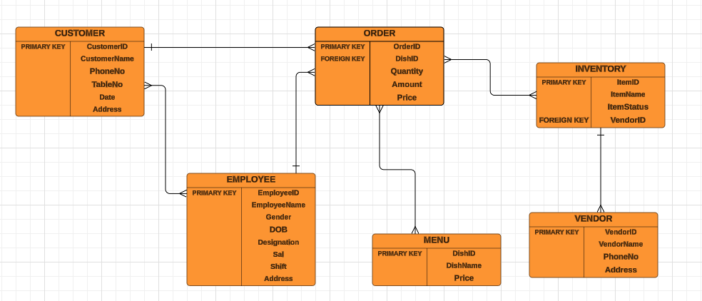

# Restaurant Management System (RMS) - SQL Database Project

A SQL Server database for managing restaurant operations: employees and shifts, customers and their orders, the menu, vendors, and inventory. It was built as a DBMS Lab project (CSL-220, Bahria University, Karachi, Fall 2023).

> **Note:** The original repository description referred to a "hotel" management system. The database script (`[RMS]`) and the project report both describe a **restaurant** management system, so this README follows the code.

## Entity-Relationship Diagram



## Features

- **Schema:** 9 tables covering employees, customers, menu, orders, vendors, inventory, and audit logs
- **Views:** 6 reporting views (sales, item status, high-spending customers, top employees, shared dishes, average order value)
- **Stored procedures:** 6 (add dish to menu, daily sales, employee order count, monthly sales, out-of-stock notification, increment)
- **Functions:** 15 scalar/table-valued functions (for example `Annual_Salary`, `Order_Summary`, `Discount`, `Get_Emp_By_Shift`)
- **Triggers:** 2 (`Trigger_For_Customer_Table`, `For_Emp_Table`) that write to the logging tables
- **Logging tables:** `Logs_For_Customer` and `Logs_For_Employee`

## Database Tables

| Table | Purpose |
|---|---|
| `Emp` | Employee details, designation, salary, shift |
| `Customer` | Customer contact details, table number, status |
| `Menu` | Dishes and prices |
| `Order` | Order lines (dish, quantity, amount, date) |
| `EmpCustomerOrder` | Links employee, customer, order, and dish |
| `Vendor` | Supplier details |
| `Inventory` | Items supplied by vendors, with status |
| `Logs_For_Customer` | Audit log for customer changes |
| `Logs_For_Employee` | Audit log for employee changes |

## Project Structure

```
HOTEL-MANAGEMENT-SYSTEM-SQL/
├── README.md
├── sql/
│   └── scriptOFRMS.sql        # Full database script (T-SQL)
├── report/
│   └── DBMS-ProjectReport-RMS-1.docx   # Project report
└── docs/
    └── images/                # Figures extracted from the report
```

## Requirements

- Microsoft SQL Server (2016 or later recommended)
- SQL Server Management Studio (SSMS) or Azure Data Studio

## Setup

1. Open SSMS and connect to your SQL Server instance.
2. Open `sql/scriptOFRMS.sql`.
3. Run the script. It creates the `RMS` database, then the tables, views, procedures, functions, and triggers. The script uses `GO` batch separators, so run it as a whole script (F5).
4. Confirm the setup:

```sql
USE RMS;
SELECT name FROM sys.tables;
```

The script creates the database files in `C:\SQLDATA\`. If that folder does not exist on your machine, edit the `FILENAME` values at the top of the script before running it.

## Project Team

| Enrollment | Name |
|---|---|
| 02-134221-065 | Amna Ramzan |
| 02-134221-091 | Syeda Laiba Rehman |
| 02-134221-069 | Laiba Tariq |

**Course instructor:** Mr. Malik M. Ali
**Lab instructor:** Ms. Hafsa Munawar